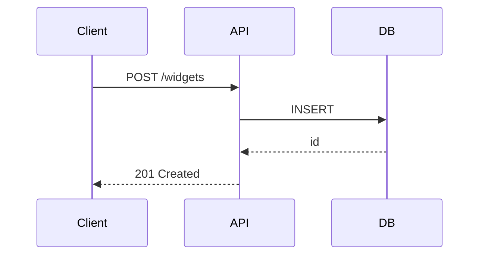

# Specification Document

This skill is for producing technical specification documents during the discovery phase of a story — the deliverable that describes *how* a feature will be implemented before code is written. The output is a markdown file following the team's required structure.

## When this skill runs

The user has explicitly asked for a spec document. Your job is to produce one — populated with real content, not placeholders — that follows the structure below.

## Process

Work through these steps in order. Don't skip the inventory step; it determines whether you need to ask anything at all.

### 1. Inventory what you already know

Before asking the user anything, take stock of what's already available:

- **The conversation so far.** Has the user described a problem, a feature, a bug, an upstream decision? Have they pasted code, error messages, screenshots, or links?
- **Attached files.** PDFs, design docs, tickets, transcripts, code files — read them and extract anything relevant to the spec.
- **Prior context in the session.** If you've been debugging or designing something with the user already, that's likely the substance of the spec.

Write a mental map of what each chapter would contain *if you wrote the spec right now*. The chapters where your map is thin or empty are where you'll need to ask.

### 2. Ask clarifying questions — but only for real gaps

After the inventory, ask about what you genuinely don't know. Group related questions together; don't drip-feed one at a time. A good rule of thumb: if you'd be making something up to fill a chapter, ask. If you have a defensible answer from context, don't ask — just draft it and let the user correct it in review.

Common gaps worth asking about:
- **Business context / why now** — often missing from purely technical conversations
- **Non-functional requirements** — performance targets, scale, security, observability are rarely mentioned in passing
- **Alternative implementations the user considered** — if you only have one approach in mind, ask whether others were on the table
- **Constraints you can't infer** — deadlines, team capacity, dependencies on other work

If the user has clearly given you everything, skip straight to drafting and flag any thin sections in the final document.

### 3. Draft the document

Produce the spec as a markdown file following the structure in the next section. Save it in the current working directory with a descriptive name (e.g. `spec-<feature-name>.md`).

If the project has an obvious docs location (a `docs/`, `specs/`, or `design-docs/` folder near the working directory), put the file there instead of the root — but don't go hunting; if nothing obvious exists, the working directory is fine.

After writing the file, briefly note any sections where you made assumptions or where information was thin, so the user knows what to verify.

## Document structure

Use this exact structure. Every spec must include all four top-level sections.

```markdown
# [Feature / story name]

## Intro

### The problem

[What is broken, missing, or being asked for — in plain language. Avoid jargon here; this section should be readable by someone outside the team. State the user-facing or system-facing pain point concretely.]

### Why we got this assignment

[Business context, customer driver, or upstream decision that put this story on the board. Anyone reading later should understand *why now* — what changed, who asked, what does it unblock.]

## Requirements

### Functional requirements

[What the system must do. Behaviors, inputs, outputs, edge cases. Be specific enough that someone could write test cases from this. Use bullets or numbered lists; one requirement per item.]

### Non-functional requirements

[Constraints beyond what the system does — common categories include performance, scale, security, observability, backward compatibility, operational constraints. Include the ones that matter for this story; you don't need to enumerate every category.]

## Proposed Implementation

[Break the implementation into the distinct areas/topics that need design decisions (e.g., "Database schema", "API design", "Authentication flow", "Background job processing"). Each area gets its own subsection. Within each area, lay out the **top options only** — maximum 4, minimum 1.

Curate hard: if only 2 approaches are genuinely worth considering, present only those 2. Don't pad with weak options to fill space. If only 1 approach is viable, present that one and briefly note in the Recommendation why alternatives were ruled out.

Every area must end with an explicit recommendation. A spec is a decision document, not a list of possibilities.

Include the artifacts that fit the story: ERD, UML, sequence diagrams, API contracts, data flow, infographics. Use what clarifies; skip what doesn't. Embed diagrams as mermaid code blocks when possible so they render in markdown viewers.]

### [Area / topic 1, e.g. "Database schema"]

**Option A: [name]**
[Description of the approach.]

Trade-offs:
- Pros: [...]
- Cons: [...]
- Complexity / risk / cost / time: [...]

**Option B: [name]**
[Description of the approach.]

Trade-offs:
- Pros: [...]
- Cons: [...]
- Complexity / risk / cost / time: [...]

**Recommendation:** [Option X, with a one- to two-sentence rationale tying back to the trade-offs above.]

### [Area / topic 2, e.g. "API design"]

[Same structure: Option A, Option B, ..., Recommendation.]

## Summary

- **Chosen approach:** [short recap of what's being built]
- **Key decisions:** [the 2–5 decisions that shaped the design and why]
- **Out of scope / follow-ups:** [items deferred to future stories, with a brief note on why]
```

## Writing guidance for each section

### Intro — The problem
Plain-language framing. If the spec reads like the problem section was written by the engineer who'll build it, rewrite it. Imagine a new hire reading this in six months.

### Intro — Why we got this assignment
This is about context, not justification. Don't argue *for* doing the work — explain *what made it land on the team's desk*. A customer escalation, a quarterly OKR, a dependency from another team's roadmap, a bug that finally crossed a threshold — name it.

### Requirements — Functional
Each requirement should be testable. "The system handles errors gracefully" is not a requirement; "On API timeout, the client retries up to 3 times with exponential backoff, then surfaces a user-facing error message" is.

### Requirements — Non-functional
Cover what's actually relevant. Common categories to consider: performance, scale, security, observability, backward compatibility, operational constraints. You don't need to list every category with "N/A" — just include the ones that matter for this story. If you're not sure whether something matters, include it.

### Proposed Implementation
Structure this section by **area of the system being designed** (database schema, API surface, auth flow, etc.) — not by approach. Within each area, present the options as **Option A**, **Option B**, etc., each with a description and explicit trade-offs.

**Curate the options.** Present only the top contenders — **up to 4, no more**. If only 2 approaches are genuinely worth considering, present just 2. If only 1 is viable, present 1 and explain in the Recommendation why others were ruled out. Listing weak options for completeness wastes the reader's time and dilutes the recommendation.

Every area must end with a **Recommendation**. The skill is strict on this: a spec without recommendations is not a spec. If you genuinely can't recommend yet because information is missing, say what's missing and what needs to happen to resolve it — but still pick the option you'd bet on today.

When trade-offs are quantitative or comparable across options, a small comparison table is clearer than parallel prose:

| | Option A | Option B |
|---|---|---|
| Complexity | Low | High |
| Migration risk | None | Requires backfill |
| Query performance | ~50ms | ~5ms |

For diagrams, prefer mermaid:

````markdown

````

If a diagram is more complex than mermaid handles well, describe it in prose and note that a diagram will be added (e.g. linked from a Miro board or attached separately).

### Summary
Three bullet groups, in this order: chosen approach, key decisions, out-of-scope. Keep it short — if the summary is longer than half a page, the reader will just re-read the rest of the doc instead.

## Output

- File format: markdown (`.md`)
- Location: the current working directory (or an obvious docs folder like `docs/`, `specs/`, or `design-docs/` if one exists nearby)
- Filename: `spec-<short-feature-name>.md` (kebab-case)
- After writing, send a brief message telling the user where the file was saved and noting any thin sections or assumptions they should review
